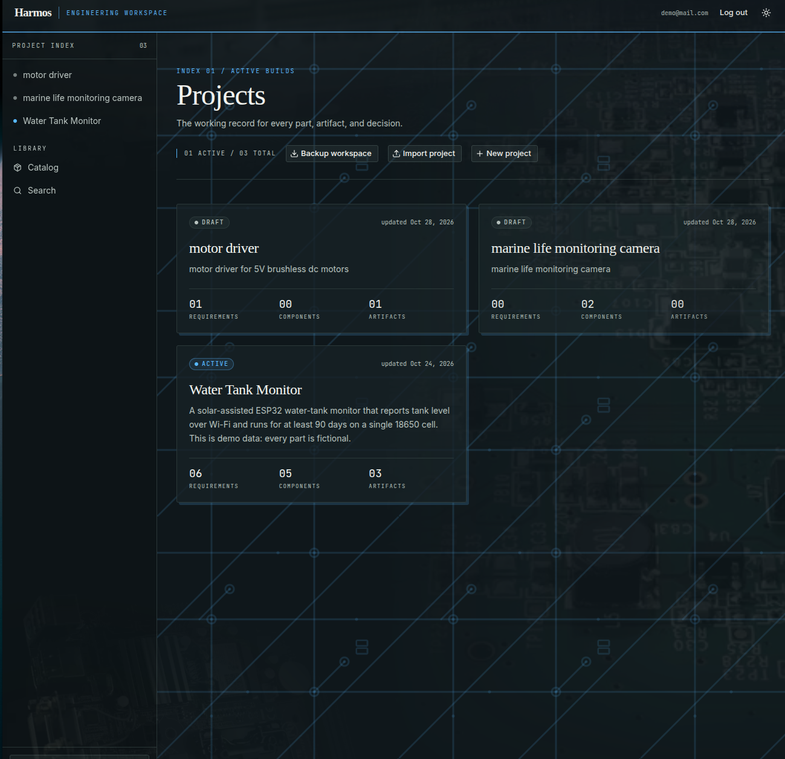
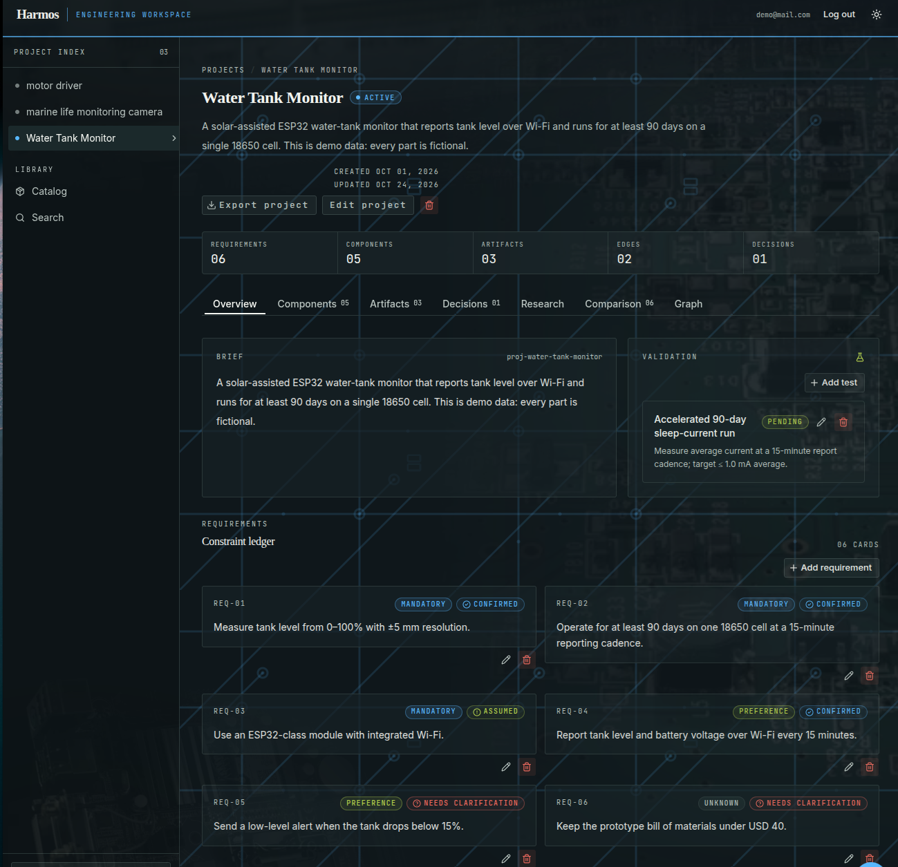
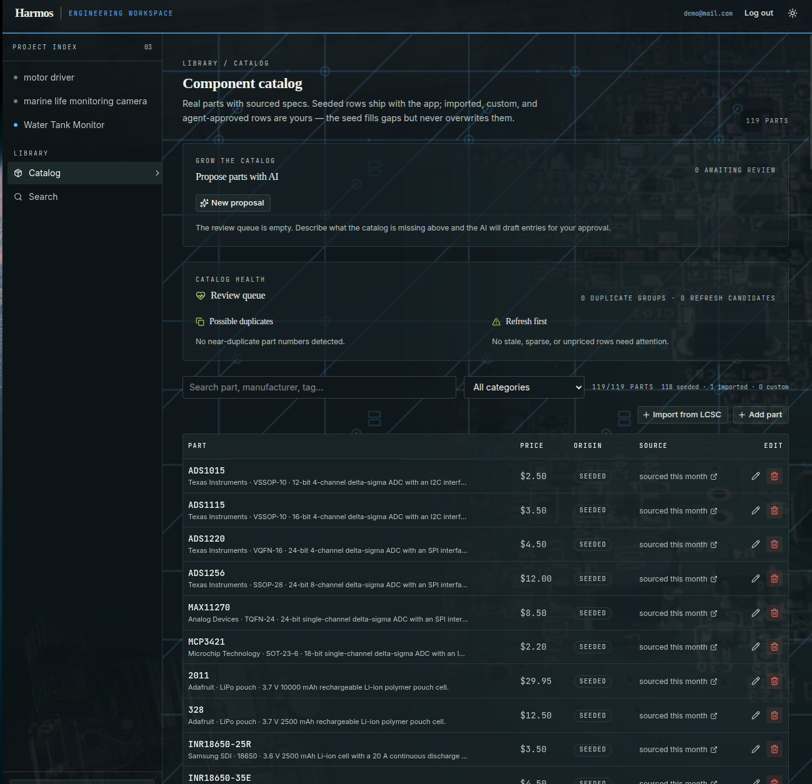
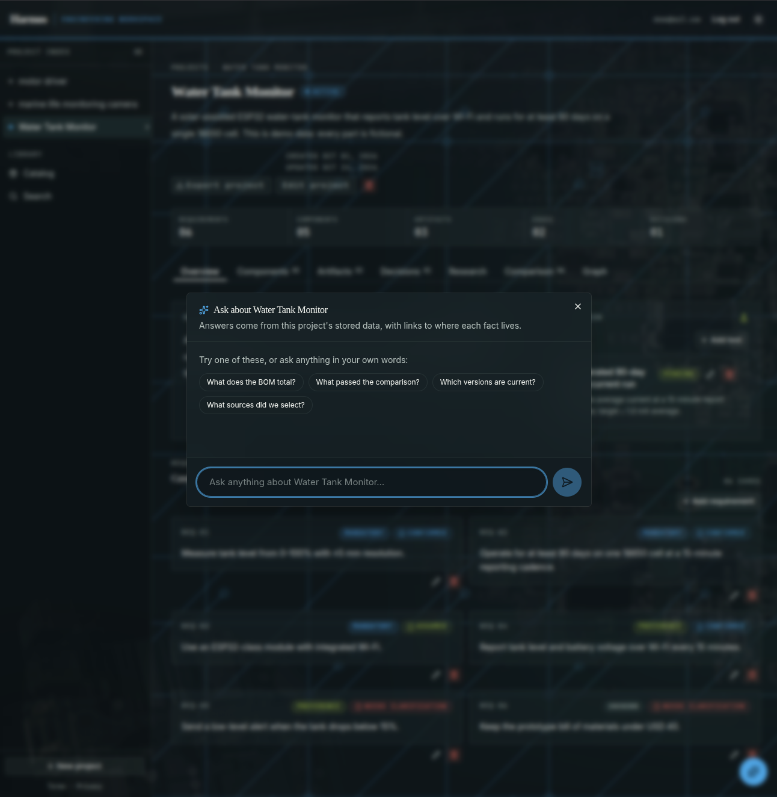

# Harmos

Harmos is an open-source, self-hostable, AI-assisted engineering workspace for
hardware makers. It takes a project from a rough idea — "an ESP32 water-tank
monitor that runs three months on battery" — to a researched, documented,
reproducible build. Requirements, sources, component comparisons, datasheets,
hardware files, firmware versions, BOMs, design decisions, and validation live
in one connected project graph. The project is the unit of work; every part,
artifact, and decision belongs to it.

## What Harmos is / is not

**Is**

- **Project-centric.** Every requirement, resource, component, artifact, edge,
  decision, and test hangs off a project.
- **Deterministic where it matters.** Constraint checks, dependency ripples, BOM
  totals, version resolution, and comparison scores are computed in code, not
  guessed by a model. The AI explains and drafts; humans approve.
- **Self-hostable.** Next.js, Prisma, and a single-file SQLite database. One
  `docker compose up` brings the workspace online. Your data stays on your
  machine.
- **Open source.** MIT licensed.

**Is not**

- A chatbot.
- A distributor frontend (though it can import info into its catalog).
- A CAD tool.
- A BOM-only app.

## Screenshots

Screenshots show the seeded demo workspace (fictional Water Tank Monitor
project, `demo@mail.com` account).









## Features

- **Projects** with requirements, constraints, components, artifacts, decisions,
  validation tests, and research sources — plus CSV import and JSON backup /
  restore of whole projects or the full workspace.
- **Deterministic comparison engine** scoring catalog candidates against hard
  constraints, with AI-written explanations and one-click BOM promotion.
- **Component catalog** Add real parts with sourced specs, category-aware
  entry forms, health/duplicate review queues, gap analysis, and AI-assisted
  proposals that require human approval.
- **LCSC distributor import** by product code (public detail endpoint, no
  keys needed; signed official API as fallback).
- **Artifact uploads** (schematics, firmware, datasheets, test logs) with
  SHA-256 recorded at upload time and version resolution.
- **Change-impact view**: dependency ripple preview and graph before applying
  a swap.
- **Multi-project search** across projects, catalog, decisions, and resources.

## How to run

Prerequisites: Node.js 20+ and pnpm 9+ (Docker for the container path).

```bash
cp .env.example .env
pnpm install            # postinstall runs prisma generate
pnpm prisma migrate dev # creates prisma/data/harmos.db
pnpm seed               # demo project + catalog (idempotent: fills gaps only)
pnpm dev                # http://localhost:3000
```

Open the app and create the first account via **Sign up** — login is always
required. To start from a clean demo database:

```bash
pnpm db:reset
```

The local SQLite file is `prisma/data/harmos.db` (Prisma resolves
`file:./data/harmos.db` relative to `prisma/schema.prisma`). Uploaded files
live under `HARMOS_UPLOAD_DIR` (`./data/uploads` by default). Both are
gitignored.

Docker path:

```bash
docker compose up --build
# open http://localhost:3000
```

The image builds the app, applies migrations, and seeds the demo database at
build time; on first start the entrypoint copies that seeded SQLite file into
the `harmos-data` volume at `/data/harmos.db`. Uploads live in the same
volume at `/data/uploads`, the AI cache in `harmos-cache` at
`/data/.cache`. To reset everything:

```bash
docker compose down -v
```

## Configuration

All in `.env` (see `.env.example`):

| Variable               | Default                  | Purpose                                              |
| ---------------------- | ------------------------ | ---------------------------------------------------- |
| `DATABASE_URL`         | `file:./data/harmos.db`  | Prisma SQLite location.                              |
| `AI_BASE_URL`          | `https://api.meta.ai/v1` | OpenAI-compatible base URL for AI features.          |
| `AI_API_KEY`           | `your_key_here`          | Provider key. Leave the placeholder to stay offline. |
| `AI_MODEL`             | `muse-spark-1.3`         | Model id sent by the AI client.                      |
| `HARMOS_CACHE_DIR`     | `./.cache`               | AI disk cache root.                                  |
| `HARMOS_DEMO_MODE`     | `0`                      | Replay cached AI responses when set to 1.            |
| `HARMOS_UPLOAD_DIR`    | `./data/uploads`         | Artifact file storage root.                          |
| `HARMOS_CATALOG_ADAPTER` | `local`                | Catalog backend (`local` today; vendor adapters fail loudly until wired). |
| `HARMOS_SESSION_SECRET` | empty (ephemeral)       | Session signing secret; set it to keep logins across restarts. |
| `LCSC_API_KEY` / `LCSC_API_SECRET` | empty       | LCSC distributor credentials (optional; official API is the fallback when set). |
| `LCSC_API_BASE_URL`    | `https://api.lcsc.com`   | LCSC API base URL.                                   |

## Commands

```bash
pnpm dev                # local dev server
pnpm build && pnpm start # production build + serve
pnpm test               # unit tests (node --import tsx over tests/)
pnpm lint               # eslint
pnpm tsc --noEmit       # typecheck
pnpm seed               # idempotent seed: demo project (if missing) + catalog gaps
pnpm db:reset           # destructive: wipe and re-seed the demo database
pnpm catalog:import -- <file.csv>  # bulk catalog upsert (validated)
```

Quality gates before finishing work: `pnpm tsc --noEmit`, `pnpm lint`,
`pnpm test`, `pnpm build`.


## Origin of the name

Harmos (ἁρμός) is Greek for "joint, fitting" — the thing that makes separate
parts load-bearing together.
